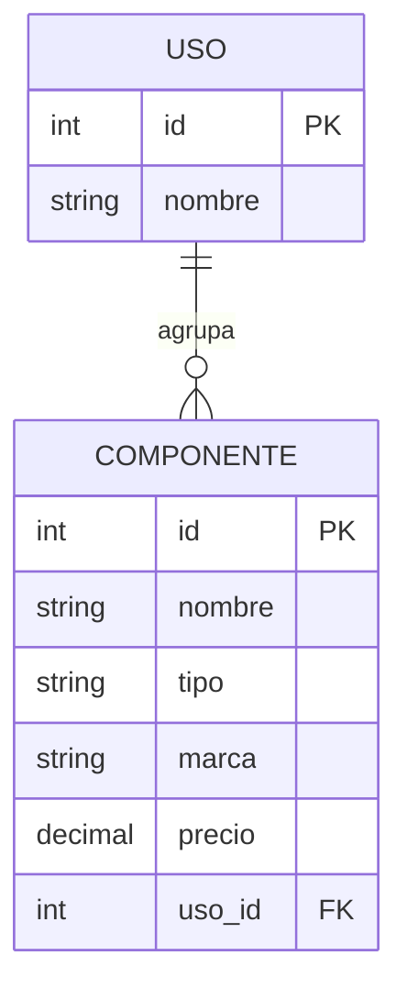

# Componentes — API (Backend)

Backend del TP de **Tecnologías Web** (TUARI/UNICEN). API REST en **NestJS** con persistencia en
**PostgreSQL** vía **TypeORM**, que administra componentes de PC agrupados por tipo de uso.

- **Relación 1 a N:** `Uso` (1) → `Componente` (N).
- CRUD completo de ambas entidades + **filtrado** por uso y **búsqueda** por nombre.
- Colección de Postman con todos los casos de uso incluida en `postman/`.

## Tecnologías

- NestJS + TypeScript
- TypeORM + PostgreSQL (`pg`)
- Docker / docker-compose (PostgreSQL + Adminer)

## Modelo de datos

**Uso**

| Campo  | Tipo   |
| ------ | ------ |
| id     | int PK |
| nombre | string |

**Componente**

| Campo   | Tipo              |
| ------- | ----------------- |
| id      | int PK            |
| nombre  | string            |
| tipo    | string            |
| marca   | string            |
| precio  | decimal           |
| uso_id  | int FK → Uso.id   |



## Requisitos

- Node.js y npm
- Docker (para la base de datos)

## Puesta en marcha

```bash
# 1. instalar dependencias
npm install

# 2. levantar PostgreSQL + Adminer
docker compose up -d

# 3. levantar la API en modo desarrollo
npm run start:dev
```

La API queda en `http://localhost:3000`. Adminer (administrador de la DB) en `http://localhost:8080`.

Al iniciar, si la tabla de usos está vacía, se **siembran** 4 usos: Gaming, Oficina, Doméstico y Estudio.

## Variables de entorno

La conexión a la base se lee de variables de entorno, con valores por defecto para desarrollo local
(ver `.env.example`). Sin `@nestjs/config`, un archivo `.env` **no se carga automáticamente**; en
producción (Render) se configuran desde el panel del servicio.

| Variable    | Default        |
| ----------- | -------------- |
| DB_HOST     | localhost      |
| DB_PORT     | 5432           |
| DB_USERNAME | postgres       |
| DB_PASSWORD | secret123!     |
| DB_NAME     | pc_prearmadas  |
| PORT        | 3000           |

## Endpoints

### Usos

| Método | Ruta        | Descripción                          |
| ------ | ----------- | ------------------------------------ |
| GET    | `/usos`     | Listar usos                          |
| GET    | `/usos?nombre=gam` | Buscar usos por nombre (para elegir el uso al crear un componente) |
| GET    | `/usos/:id` | Obtener un uso por id                |
| POST   | `/usos`     | Crear un uso (400 si falta el nombre, 409 si ya existe) |
| PATCH  | `/usos/:id` | Actualizar un uso (400 si el nombre es vacío, 409 si ya existe) |
| DELETE | `/usos/:id` | Eliminar un uso (409 si tiene componentes) |

### Componentes

| Método | Ruta                          | Descripción                                    |
| ------ | ----------------------------- | ---------------------------------------------- |
| GET    | `/componentes`                | Listar componentes (con su uso embebido)       |
| GET    | `/componentes?usoId=1`        | **Filtrar** por uso                            |
| GET    | `/componentes?nombre=ryzen`   | **Buscar** por nombre (parcial, sin distinguir mayúsculas) |
| GET    | `/componentes/:id`            | Obtener un componente por id                   |
| POST   | `/componentes`                | Crear un componente (400 si el body es inválido, 404 si el uso no existe) |
| PATCH  | `/componentes/:id`            | Actualizar un componente (400 si un campo es inválido, 404 si no existe el componente o el uso) |
| DELETE | `/componentes/:id`            | Eliminar un componente                         |

El filtro y la búsqueda se pueden **combinar**: `/componentes?usoId=1&nombre=ryzen`.

## Validaciones y códigos de estado

Las validaciones se hacen a mano (sin `class-validator`), con las excepciones de NestJS.

| Código | Cuándo |
| ------ | ------ |
| 200 | Consulta, edición o borrado correctos. Un filtro sin resultados (ej. `?usoId=999`) también devuelve 200 con `[]` |
| 201 | Alta correcta de un uso o de un componente |
| 400 | Body inválido (campos faltantes, vacíos —incluido el nombre vacío de un uso en POST y PATCH—, `precio` negativo, `usoId` no entero), o un `id` / `usoId` que no es un número (`ParseIntPipe`). En un componente se devuelven **todos** los errores juntos |
| 404 | El uso o el componente no existe (también al crear/editar un componente con un `usoId` inexistente) |
| 409 | Conflicto con algo que ya existe: uso con nombre duplicado (POST o PATCH), o borrar un uso que tiene componentes |

En `PATCH /componentes/:id` solo se validan los campos que vienen en el body (actualización parcial).

## Colección de Postman

En [`postman/Componentes.postman_collection.json`](postman/Componentes.postman_collection.json),
con todos los casos de uso: 12 requests en Usos y 13 en Componentes, incluidos los casos de error
400 / 404 / 409. Importarla en Postman con **Import → Files** y usar la variable `baseUrl` (por
defecto `http://localhost:3000`).

## Tests

```bash
npm run test
```

## Autor

Benjamín Tiseira — Tecnologías Web, TUARI/UNICEN.
